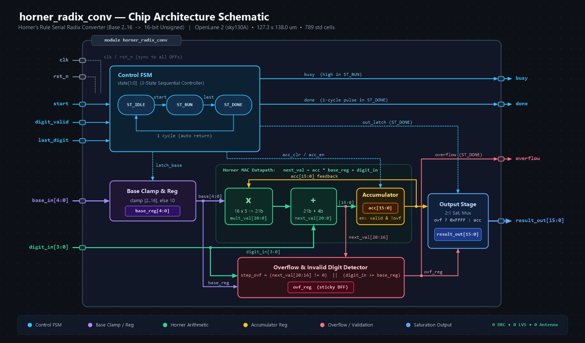

# Week 1: Horner's Rule Serial Radix Converter

Converts an MSB-first digit stream in any radix `base_in` (`2..16`) into a 16-bit unsigned binary integer using Horner's rule:

`acc_next = acc * base + digit`

## Chip Schematic



## Pinout (`horner_radix_conv`)
- `clk`, `rst_n`: Clock & active-low async reset
- `start`: Pulses to latch `base_in[4:0]` and reset the accumulator
- `digit_valid`, `last_digit`, `digit_in[3:0]`: Streaming digit input
- `result_out[15:0]`, `done`, `overflow`, `busy`: Registered output & status flags

## Run
```bash
make sim   # Compile & run self-checking testbench
make wave  # Open GTKWave
make gds   # Run OpenLane 2 (sky130A) RTL-to-GDSII flow
```
