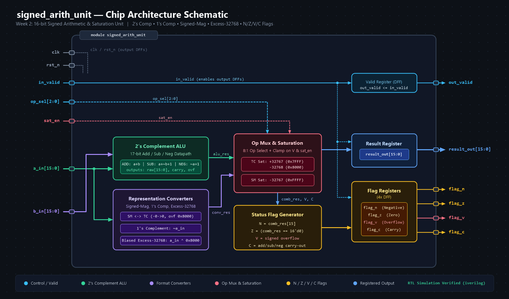

# Week 2: 16-bit Signed Arithmetic & Saturation Unit

A synchronous 16-bit signed arithmetic and representation-conversion unit supporting 2's complement addition/subtraction/negation, 1's complement, Signed-Magnitude ↔ 2's complement conversion, Excess-32768 biased conversion, optional saturation, and standard `N, Z, V, C` status flags.

## Chip Schematic



## Operations (`op_sel[2:0]`)

| `op_sel` | Operation | Description |
| :--- | :--- | :--- |
| `000` | `OP_ADD` | 2's complement `a_in + b_in` (saturates to `0x7FFF` / `0x8000` if `sat_en=1`) |
| `001` | `OP_SUB` | 2's complement `a_in - b_in` (saturates to `0x7FFF` / `0x8000` if `sat_en=1`) |
| `010` | `OP_NEG` | 2's complement `-a_in` (saturates `-32768` → `+32767` if `sat_en=1`) |
| `011` | `OP_SM2TC` | Signed-Magnitude → 2's complement (`-0` normalized to `0`) |
| `100` | `OP_TC2SM` | 2's complement → Signed-Magnitude (`-32768` saturates to `-32767` `0xFFFF` if `sat_en=1`) |
| `101` | `OP_ONES` | 1's complement (`~a_in`) |
| `110` | `OP_TC2BIAS` | 2's complement → Biased Excess-32768 (`a_in ^ 0x8000`) |
| `111` | `OP_BIAS2TC` | Biased Excess-32768 → 2's complement (`a_in ^ 0x8000`) |

## Pinout (`signed_arith_unit`)

- `clk`, `rst_n`: Clock & active-low async reset
- `in_valid`: Triggers operation & latches outputs on rising clock edge
- `op_sel[2:0]`, `sat_en`: Operation selector & saturation mode enable
- `a_in[15:0]`, `b_in[15:0]`: 16-bit operands
- `result_out[15:0]`, `out_valid`: Registered 16-bit result & valid pulse
- `flag_n`, `flag_z`, `flag_v`, `flag_c`: Negative, Zero, Signed Overflow, and Carry-out flags

## Run

```bash
make sim   # Compile & run self-checking testbench
make wave  # Open GTKWave
```
